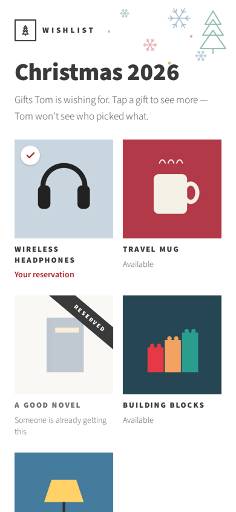
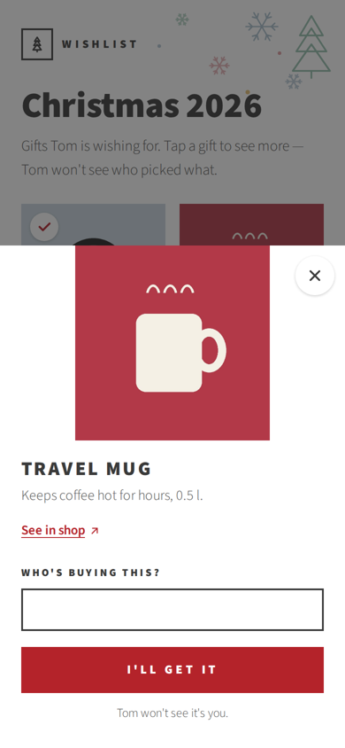
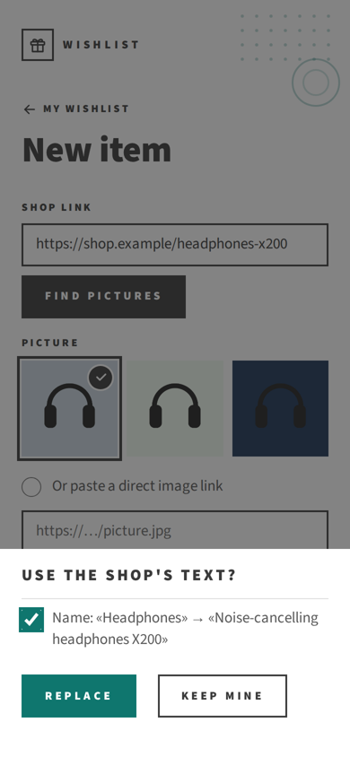
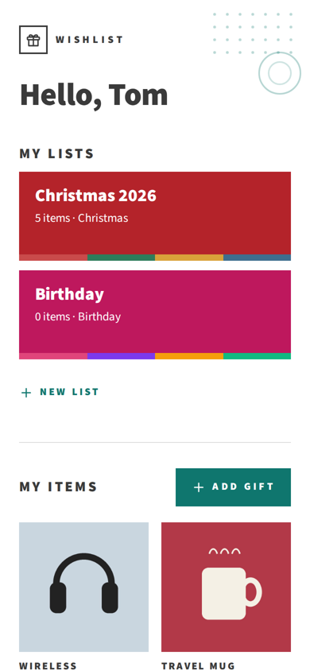

# Wish List

A small, self-hosted wishlist app for a family or a circle of friends. Everyone keeps their own gift lists, shares them with a link, and guests reserve gifts so nobody buys the same thing twice. The owner of a list never sees what was reserved, so the surprise stays intact.

It runs as one small Docker container with an SQLite database, works well on phones, and speaks English and Polish.

| Guest view of a shared list | Tap a gift to reserve it | Adding a gift from a shop link | A member's home page |
| :---: | :---: | :---: | :---: |
|  |  |  |  |

**Contents:** [Features](#features) · [Try it in 5 minutes](#try-it-in-5-minutes) · [How it works](#how-it-works) · [Install for real](#install-for-real) · [Configuration](#configuration) · [Pictures](#pictures-and-fetch-protections) · [Exposing the app](#exposing-the-app) · [Privacy](#privacy-notes) · [Backup](#backup) · [Development](#development)

## Features

- **No passwords.** Each member gets a personal login link. Guests need nothing at all.
- **Gift lists with pictures.** Paste a shop link and tap *Find pictures*: the app offers up to three product pictures from the page and fills in the name and description. You can also paste a picture link yourself, or skip the picture.
- **Share by link, email or SMS.** Anyone with a list's share link can open it on their phone, no account needed.
- **Reservations that keep the surprise.** Guests tap a gift and say who's buying it. Other guests see it as reserved; the list owner never does.
- **A colour theme per list:** Classic, Christmas or Birthday.
- **An admin page** to add members, resend lost links and, only when you ask, see who reserved what.
- **English and Polish**, easy to add more.
- **Small and private:** one container, one SQLite file, fonts and pictures served by the app itself (guests' browsers don't contact shops or Google).

## Try it in 5 minutes

You only need [Docker](https://docs.docker.com/get-docker/) and `git`. This runs the app on your own computer with throwaway data.

```sh
git clone https://github.com/butthe4d/wish-list.git
cd wish-list
docker build -t wishlist .
docker run --rm -it -p 8000:8000 \
  -e BASE_URL=http://localhost:8000 \
  -e SECRET_KEY=$(openssl rand -hex 32) \
  -e ADMIN_EMAIL=you@example.com -e ADMIN_NAME=You \
  -v "$PWD/try-data:/data" \
  wishlist
```

The log prints a line like `Admin link: http://localhost:8000/u/…`. Open it in your browser and you're in as the admin. Press Ctrl+C to stop; delete the `try-data` folder to start over.

Then try the main flow from [How it works](#how-it-works): create a list, add a gift from a shop link, open the list's share link in a private browser window and reserve something.

<details>
<summary>Without Docker (Python 3.12+ and <code>make</code>)</summary>

```sh
git clone https://github.com/butthe4d/wish-list.git
cd wish-list
python3 -m venv .venv
.venv/bin/pip install -e '.[dev]'
make dev-env   # writes dev.env with a generated SECRET_KEY and this machine's address
make run       # prints "Admin link: …" on the first run, then serves on port 8000
```

Edit `ADMIN_EMAIL` / `ADMIN_NAME` in `dev.env` before the first `make run` if you like. Data lives in `dev.db` and `devdata/` in the repo folder.
</details>

## How it works

1. **The admin adds people.** Open your admin link, go to *Admin* and add each household member with a name and email. Each one gets a personal link, emailed if email is set up, otherwise shown on screen once for you to pass on. That link is their login, so they should keep it private.
2. **Members make lists.** A member creates a list (for example "Christmas 2026"), picks its theme, and adds gifts. For each gift they paste the shop link and tap *Find pictures*: the app suggests pictures and fills in the name and description, asking before it changes anything they already typed.
3. **Members share a list.** The list page has a share link to copy, plus *Send by email* and *Send by text message* when those are set up. Sharing works with anyone, member or not.
4. **Guests reserve gifts.** The share link opens a grid of gifts. Tapping one shows the details and a *Who's buying this?* field. Once reserved, everyone else sees the gift as reserved. The list owner sees nothing, not even on their own page.
5. **The admin keeps an eye on things.** If an owner deletes a gift someone already reserved, the admin page marks that member with *Needs attention*. Clicking *Show reservations* on that member's page reveals the details, for that member and that page view only. If someone loses their link, *Change key and send new link* gives them a new one.

Opening your own list's share link while logged out (or in another browser) shows you what guests see, including reservations, so don't do that if you want to stay surprised.

## Install for real

For an always-on setup, for example on a home server:

1. Put [`docker-compose.yml`](docker-compose.yml) in a new folder and edit `BASE_URL` (the address people will use, see [Exposing the app](#exposing-the-app)) and `ADMIN_EMAIL`.
2. Next to it, create a `.env` file with a secret key (compose refuses to start without it):

   ```sh
   echo "SECRET_KEY=$(openssl rand -hex 32)" > .env
   ```

3. Start it and get your admin link:

   ```sh
   docker compose up -d
   docker compose logs wishlist | grep "Admin link"
   ```

The compose file uses the image built from this repository and published to `ghcr.io/butthe4d/wish-list`. To build it yourself instead, replace the `image:` line with `build: .` (with the compose file inside a clone of this repository).

The database lives in `./data/wishlist.db` and item pictures in `./data/images/`. Database upgrades run automatically at every start. The container starts as root only to make `/data` writable, then runs the app as uid 1000. With a `user:` override it runs as that user, and `./data` must already be writable by it.

**Upgrading:** back up `data/` first (see [Backup](#backup)), then `docker compose pull && docker compose up -d`. Going back to an older version after an upgrade is not supported.

## Configuration

All configuration comes from environment variables.

| Variable | Required | Default | Description |
| --- | --- | --- | --- |
| `BASE_URL` | yes | | Public URL of the app, for example `https://wish.example.com`. Every link the app creates is built from it. |
| `SECRET_KEY` | yes | | At least 32 characters. Signs sessions and derives share links. See below. |
| `DATABASE_URL` | no | `sqlite:////data/wishlist.db` | SQLAlchemy URL. |
| `ADMIN_EMAIL` | no | | Email of the first admin, created on first start when no members exist. |
| `ADMIN_NAME` | no | part of `ADMIN_EMAIL` before `@` | Name of the first admin. |
| `DATA_DIR` | no | `/data` | Folder for item pictures (`DATA_DIR/images`). Keep it on the same volume as the database. The Docker image expects `/data`. |
| `FETCH_DENY_CIDRS` | no | | Extra networks the server must never fetch from. See [Pictures](#pictures-and-fetch-protections). |
| `DEFAULT_LANGUAGE` | no | `en` | `en` or `pl`. Used when neither the member, a cookie nor the browser picks a language. |
| `SMTP_HOST` | no | | Enables email. Without it, links are shown on screen instead of emailed. |
| `SMTP_PORT` | no | `587` | |
| `SMTP_SECURITY` | no | `starttls` | `starttls`, `ssl` or `none`. |
| `SMTP_USER` | no | | |
| `SMTP_PASSWORD` | no | | |
| `SMTP_FROM` | no | `SMTP_USER` | Sender address. |
| `GSMSERVICE_TOKEN` | no | | Enables SMS sharing. Without it, no SMS UI is shown. |
| `GSMSERVICE_SENDER` | no | | Sender name shown on the SMS. |

### SECRET_KEY

Generate a long random value (either command works):

```sh
openssl rand -hex 32
python3 -c "import secrets; print(secrets.token_urlsafe(48))"
```

Changing `SECRET_KEY` logs everyone out and breaks every share link already sent (share links are derived from the key and are not stored). Personal links keep working, because only their hashes are stored.

### Email with Gmail

Create an [app password](https://myaccount.google.com/apppasswords) (this needs 2-step verification), then set:

```yaml
SMTP_HOST: smtp.gmail.com
SMTP_PORT: "587"
SMTP_SECURITY: starttls
SMTP_USER: you@gmail.com
SMTP_PASSWORD: your-16-char-app-password
SMTP_FROM: you@gmail.com
```

### SMS with gsmservice.pl

1. Create an account at [gsmservice.pl](https://gsmservice.pl) and generate an API token.
2. Register a sender name with the service (or use one it provides).
3. Set `GSMSERVICE_TOKEN` and `GSMSERVICE_SENDER`.

Phone numbers are entered in international format, for example `+48600100200`; spaces and dashes are ignored.

## Pictures and fetch protections

When a member adds an item with a shop link, the server can look for product pictures on that page and offer up to three to choose from. From the same page it also reads the product name and description: empty fields are filled in, and if the member already typed something different the app asks before replacing it. The member can also paste a direct image URL, or use no picture. The chosen picture is downloaded once, resized (long side at most 800 px), re-encoded as a JPEG with metadata stripped, and stored under `DATA_DIR/images` with a random name. Guests' browsers never contact the shop or any third party: pictures (and fonts) are served by the app itself. A picture is served only while its item is live. Deleting an item removes its picture file, except that an item with a reservation is only soft-deleted: its picture file stays on disk (and is not served) until an admin cancels that reservation or the member is deleted. Candidate pictures that were not chosen are kept in `DATA_DIR/images/tmp`; they are not cleaned on a timer, but the next time anyone searches for pictures, candidates older than an hour are removed.

Because the server makes requests to addresses members type in, it is restricted:

- only `http` and `https`, only ports 80 and 443;
- loopback, private, link-local and other non-public addresses are refused, checked again on every redirect (at most 3);
- pages are limited to 2 MB and images to 10 MB; 8 s per request and 20 s in total, and a picture search stops after 20 s;
- each member can run 30 picture searches per hour (counted per gunicorn worker, so with several workers the effective limit is a multiple).

### FETCH_DENY_CIDRS

Private ranges are blocked automatically, but some of your own addresses look public to the app: the global IPv6 prefix of a LAN with native IPv6 (every device, including your router and other services, has an address in it), and the public IPv4 address or DDNS name of your home connection (with hairpin NAT it reaches your router and the services behind it from inside). A link pointing at them would let a member make the server talk to your internal services. List them in `FETCH_DENY_CIDRS`, comma or space separated (a bare address such as `203.0.113.7` is treated as `/32`):

```yaml
FETCH_DENY_CIDRS: "2001:db8:1234::/48, 203.0.113.7/32"
```

Here `2001:db8:1234::/48` is the LAN's IPv6 prefix and `203.0.113.7` is the household's public IPv4 address. If you use a DDNS name, list the address it currently resolves to. A malformed value stops the app from starting.

## Themes

The owner of a list picks its theme on the list page: Classic, Christmas or Birthday. The theme colours the list for its owner and for guests opening the share link. An admin sets the default theme for new lists and the design on the admin page (currently only "A — tiles"). Fonts (Source Sans 3) are bundled with the app.

## Exposing the app

The app speaks plain HTTP on port 8000 and expects TLS to be handled in front of it. Set `BASE_URL` to the public HTTPS URL, because links in emails and SMS are built from it, never from the request.

- **Cloudflare Tunnel:** point a tunnel's public hostname at `http://localhost:8000` (or `http://wishlist:8000` from another container) and set `BASE_URL` to that hostname.
- **Tailscale Funnel:** run `tailscale funnel 8000` and set `BASE_URL` to the `https://<machine>.<tailnet>.ts.net` URL.

The app trusts one level of `X-Forwarded-For/Proto/Host` headers from the proxy.

## Privacy notes

- **Personal links are passwords.** Anyone holding a member's link is that member. There is no self-service recovery: if someone loses their link, an admin uses "Change key and send new link" on the member.
- **List owners never see reservations on their own items**, in member views and in share views. Note that someone who opens their own share link while logged out, or in another browser, is a visitor like any other and sees the reservation state of that list.
- **Admins** see no reservations in the admin pages until they click "Show reservations" on one member's page; the reveal covers only that member and lasts for that one page load. When a reserved item is deleted, the admin home page shows a neutral "Needs attention" marker next to the member and admins get a neutral email (member name and link only). An admin's own items never trigger the marker or the email.
- Keys are stored only as SHA-256 hashes, and the gunicorn access log replaces keys in `/u/<key>` and `/s/<key>` with `***`.
- **Sharing caps:** each member can send at most 20 SMS and 50 emails per 24 hours.

## Backup

The data is the whole `data` folder: the SQLite database `wishlist.db` and the pictures in `images/`. Stop the container and copy the folder. For a copy while it runs, take a consistent database copy and copy `images/` alongside it:

```sh
sqlite3 data/wishlist.db ".backup 'wishlist-backup.db'"
cp -r data/images wishlist-backup-images
```

Keep the database backup and the images copy together. A database restored without its pictures works, but those items show no picture.

Keep your `SECRET_KEY` with the backup, or share links will have to be sent again.

## Adding a language

1. Add the language code and its display name to `LANGUAGE_NAMES` in `wishlist/config.py` (`SUPPORTED_LANGUAGES` and the language switcher and member form follow from it).
2. Run `.venv/bin/pybabel init -i wishlist/translations/messages.pot -d wishlist/translations -l <code>` (or `make i18n-update` first to refresh the template).
3. Translate every message in `wishlist/translations/<code>/LC_MESSAGES/messages.po`. The translation test fails on missing or fuzzy entries.
4. `make test`.

## Development

```sh
python -m venv .venv
.venv/bin/pip install -e '.[dev]'
make i18n-compile
make test
```

Run a local dev server (Flask's built-in server, reachable from other machines on your network):

```sh
make dev-env   # once: writes dev.env (git-ignored) with a generated SECRET_KEY and this machine's IP
make run       # compiles translations, runs migrations/bootstrap, serves on port 8000 (PORT=… to change)
```

The first `make run` prints `Admin link: …`. Data lives in `dev.db` and `devdata/` in the repo folder (both git-ignored).


## Licenses

The app is licensed under the [Apache License 2.0](LICENSE). It vendors these front-end assets:

- [htmx](https://htmx.org) 2.0.4, 0BSD license
- [Source Sans 3](https://github.com/adobe-fonts/source-sans) (weights 300/400/600/900, latin and latin-ext subsets, from [Fontsource](https://fontsource.org) 5), SIL Open Font License 1.1 — see `wishlist/static/fonts/OFL.txt`
